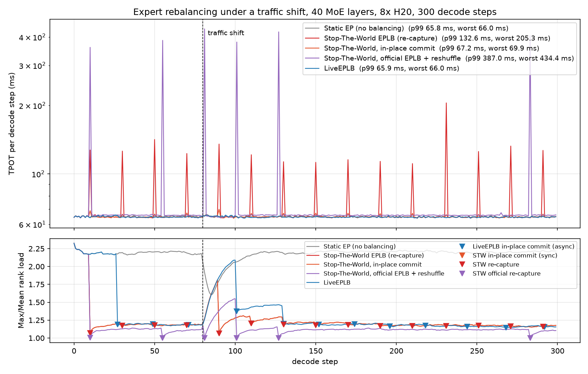
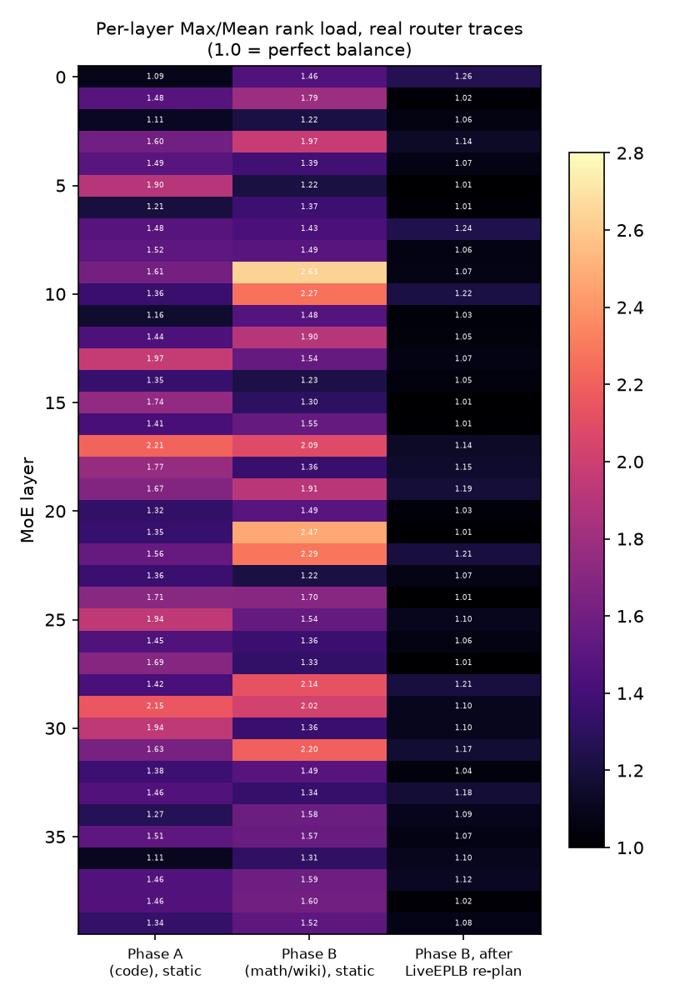

<p align="center">
  
</p>

<h1 align="center">LiveEPLB</h1>

<p align="center">
  <b>A from-scratch MoE expert live-migration engine: bounded-volume rebalancing with in-place CUDA Graph weight swap.</b>
</p>

<p align="center">
  <a href="LICENSE"></a>
  
  
  
  <a href="https://github.com/deepseek-ai/EPLB"></a>
</p>

---

When an MoE model is served with expert parallelism, each GPU owns a slice of the experts.
Real traffic is long-tailed, so the GPU holding the hot experts stalls the whole batch. The
standard fix replicates hot experts into spare slots and periodically recomputes the
placement — DeepSeek's [EPLB](https://github.com/deepseek-ai/EPLB) answers *where every
expert should go*. It does not answer *how to get there without stopping inference*: a new
layout means copying weights across GPUs, and a CUDA Graph freezes every weight pointer at
capture time, so pointing the model at relocated weights forces a re-capture.

LiveEPLB bounds the first cost by constraining the planner, and eliminates the second by
never moving a pointer at all.

## Architecture

```
                        load statistics (EMA, gloo all-reduce in a background thread)
                                      |
                                      v
                        +---------------------------+
                        |   Pinned-Base planner     |   deterministic, runs on
                        |   (live_eplb/planner.py)  |   every rank independently
                        +---------------------------+
                                      |
                       copy_tasks: only redundant slots, only layers above threshold
                                      |
       +------------------------------+------------------------------+
       |                              |                              |
       v                              v                              v
  +---------+                    +---------+                    +---------+
  | GPU 0   |                    | GPU 1   |       ...          | GPU 7   |
  |         |   NVLink P2P       |         |                    |         |
  | W_pool  |<------------------>| W_pool  |<------------------>| W_pool  |
  | [36,..] |  transfer_stream   | [36,..] |                    | [36,..] |
  +---------+                    +---------+                    +---------+
    0..31  base slots   frozen, read-only for the whole service lifetime
    32..35 redundant    the only slots the planner may touch

  compute_stream:  graph.replay() -> slot = log2phy[expert, cursor % logcnt[expert]]
  transfer_stream: pull weights into W_pool[32..35]      -> event.record()
  commit:          event.query() true -> overwrite log2phy in place (12.6 us, no re-capture)
```

The forward pass reads a *routing table* instead of a weight pointer. `W_pool` and
`log2phy` are allocated once and never reallocated, so the addresses baked into the
captured graph stay valid forever. Swapping an expert means writing bytes into a slot and
then writing a new slot index into the table — the graph never notices.

## Key Features

- **Pinned-Base layout** — only the 4 trailing redundant slots per GPU are planned, so
  migration volume is capped at 7.86 GB regardless of traffic
- **Measurement-driven planner** — replicate a hot expert only when its replica lowers the
  global max rank load; per-layer trigger, no re-plan may ever make a layer worse
- **In-place weight swap** — a redundant slot is unlinked from the routing table before
  being overwritten, and the new table is installed by a single 12.6 µs commit kernel;
  no CUDA Graph re-capture
- **Async state machine** — IDLE → PLANNING (background thread) → COPYING (transfer
  stream, polled with `event.query()`, zero blocking steps) → COMMIT
- **Deterministic planning** — identical statistics produce an identical plan on all 8
  ranks, so only a 1 KB gloo all-reduce of load statistics is needed; no placement broadcast
- **Real-router-trace benchmark** — evaluated not only on synthetic Zipf but on 8M
  collected routing decisions from the actual target model, in two distinct prompt domains

## Results at a Glance

8×H20, 40 MoE layers (the real depth of the target model), 300 decode steps. stw /
stw_inplace / live share one trigger, one planner, one copy list — only the way a placement
is *applied* differs. `stw_official` and `stw_official_inplace` additionally replace the
planner with DeepSeek's official EPLB and apply it the way a production stop-the-world does --
full reshuffle, staged two-phase copy, with and without re-capture.

```
policy      TPOT p50      p99    worst  Max/Mean last100  commits
-----------------------------------------------------------------
static        64.825   65.779   65.991             2.204        0
stw           64.638  132.639  205.299             1.174       15
stw_inplace   64.635   67.175   69.867             1.174       15
stw_official           65.787  391.494  533.297             1.112        6
stw_official_inplace   65.804  305.823  406.839             1.112        6
live                   64.512   65.887   65.995             1.189       12
```



- Stop-the-world's stall is **~98% graph re-capture** (46-68 ms each round), which
  `stw_inplace` cancels outright. The remaining ~3 ms of LiveEPLB's edge is the async
  state machine removing planning, copying and the commit round-trip from the critical path.
- The **official EPLB stop-the-world** pays the full external bill: plan ~220 ms plus a
  cycle-walk reshuffle of ~1,400 slots (~75 ms over 2-4 rounds) plus re-capture (~55 ms) --
  **a ~330 ms stall per commit**, ~5 decode steps, for Max/Mean 1.119 vs LiveEPLB's 1.166.
  The whole migration needs **one 6.29 MB scratch slot**, not a 2x-pool staging buffer.
  Giving it the in-place commit too saves only ~5%: the steepest cost of a global reshuffle
  is the plan and the turnover, both of which Pinned-Base removes by construction.
- LiveEPLB's worst step (66.02) sits **within jitter of not rebalancing at all** (65.99),
  while peak rank load drops 47% — and stays there on real router traces too.
- Honest price: after a traffic shift, LiveEPLB's balance lags the synchronous variants by
  ~35 steps (peak Max/Mean 2.09 vs 1.28) — latency tail vs. recovery speed, by design.



On **real Qwen3.6-35B-A3B router traces** (4,066 standard-dataset prompts, ~8M routed expert
assignments): the same trade holds — LiveEPLB moves **10.8× less data than a full reshuffle**
(6.55 GB vs 70.5 GB) at **1.091 vs 1.000** Max/Mean balance, and its worst step is 0.13 ms
*below* static's. Details and limitations: [`docs/stage5_experiments.md`](docs/stage5_experiments.md).

## Modules

| Path | Role |
|---|---|
| `live_eplb/planner.py` | Pinned-Base bounded planner: placement, inverse routing tables, copy-task diff |
| `live_eplb/moe_layer.py` | Address-pinned `W_pool` / `log2phy` MoE shard, single-graph `MoEStack` |
| `live_eplb/controller.py` | Async state machine: EMA collection, planning, non-blocking copy polling, commit |
| `csrc/p2p_swapper.cu` | CUDA IPC handles, `cudaMemcpyPeerAsync`, single-launch routing commit kernel |
| `live_eplb/p2p.py` | Handle exchange, coalesced peer pulls, per-rank task filtering |
| `benchmarks/run_synthetic_8gpu.py` | 8×H20 TPOT benchmark, five policies under a traffic shift |
| `benchmarks/collect_router_trace.py` | Forward hooks on the 40 MoE gates → real routing counts |
| `live_eplb/eplb_official.py` | DeepSeek EPLB, vendored verbatim, comparison baseline only |

## Installation

```bash
git clone https://github.com/Crzax/live-eplb.git
cd live-eplb
pip install torch numpy            # Stage 1 needs no GPU at all
```

> Requires Python ≥ 3.10, PyTorch ≥ 2.1. Later stages additionally need CUDA ≥ 12.0
> with `nvcc` on `PATH`, and 8 NVLink-connected GPUs for the full benchmark.

## Quick Start

```bash
python tutorials/01_eplb_diff.py      # bounded planner vs official EPLB (CPU)
python tutorials/02_cudagraph_swap.py # in-place swap under a live CUDA Graph
torchrun --nproc_per_node=8 tutorials/03_p2p_bandwidth.py   # NVLink pulls, 8 ranks
```

```
LiveEPLB :   984 tasks, 6.05 GB  (77% of redundant slots)
Official : 11520 tasks, 70.78 GB (full reshuffle)
commit vs re-capture: 0.006 ms vs 46-86 ms per placement change
```

Full TPOT benchmark (8 NVLink GPUs, 300 decode steps over a traffic shift):

```bash
pip install -e . --no-build-isolation
torchrun --nproc_per_node=8 benchmarks/run_synthetic_8gpu.py --layers 40
python benchmarks/plot_stage4.py 80
```

Real router traces (external HF hub access required for the datasets):

```bash
python benchmarks/download_prompts.py --per-source 2400
QWEN_MODEL=/path/to/Qwen3.6-35B-A3B \
  python benchmarks/collect_router_trace.py --prompts-dir results --batch 8
python benchmarks/plan_on_trace.py
```

## Project Structure

```
live-eplb/
├── live_eplb/
│   ├── planner.py              <- Pinned-Base planner, peak-driven greedy
│   ├── moe_layer.py            <- address-pinned MoE shard, graph capture, hot swap
│   ├── controller.py           <- async state machine
│   ├── p2p.py                  <- cross-process pulls over NVLink
│   ├── eplb_official.py        <- vendored DeepSeek EPLB (MIT), baseline only
│   └── EPLB_LICENSE
├── csrc/p2p_swapper.cu         <- CUDA IPC, peer copy, routing commit kernel
├── benchmarks/
│   ├── run_synthetic_8gpu.py   <- 8x H20, four policies, 300 decode steps
│   ├── collect_router_trace.py <- real router decision collection
│   ├── plan_on_trace.py        <- planner comparison on real traces
│   ├── download_prompts.py     <- standard-dataset prompt sets
│   ├── plot_stage4.py          <- timeline figures
│   └── stage4_multilayer.sh    <- one-shot: unit tests + 40-layer + 1-layer
├── tutorials/                  <- per-stage runnable demos (01, 01b, 02, 03)
├── tests/                      <- 56 invariants across planner / graph / P2P / controller
├── docs/
│   ├── figures/                <- logo & the two timeline + heatmap figures
│   ├── stage{1..5}_experiments.md
│   └── stage{1..5}_debug_notes.md   <- 27 bugs in total, most of them silent ones
├── setup.py
├── ROADMAP.md                  <- per-stage specs, pitfalls, honest estimates
└── LICENSE
```

## Documentation

Every stage ships its own experiment record and debug notes; the debug notes are where the
interesting things live — silent bugs, wrong hardware assumptions, and our own measurement
biases found in our own benchmark.

| Document | Contents |
|---|---|
| [`docs/stage1_experiments.md`](docs/stage1_experiments.md) / [`stage1_debug_notes.md`](docs/stage1_debug_notes.md) | Zipf model, bounded-vs-official trade-off measuring on paper, four bugs |
| [`docs/stage2_experiments.md`](docs/stage2_experiments.md) / [`stage2_debug_notes.md`](docs/stage2_debug_notes.md) | Two-level indirection, Python-int capture trap, commit vs re-capture |
| [`docs/stage3_experiments.md`](docs/stage3_experiments.md) / [`stage3_debug_notes.md`](docs/stage3_debug_notes.md) | CUDA IPC, P2P bandwidth vs coalescing, HBM contention |
| [`docs/stage4_experiments.md`](docs/stage4_experiments.md) / [`stage4_debug_notes.md`](docs/stage4_debug_notes.md) | Four-policy TPOT benchmark, what "zero downtime" costs; sixteen bugs |
| [`docs/stage5_experiments.md`](docs/stage5_experiments.md) / [`stage5_debug_notes.md`](docs/stage5_debug_notes.md) | Real Qwen3.6 router traces; three env bugs, one sample-size lesson |
| [`ROADMAP.md`](ROADMAP.md) | Per-stage specs, pitfalls worth knowing before writing the code |

## Prior art

- **[SwiftBalancer](https://github.com/vllm-project/vllm/issues/22246)** (vllm-ascend)
  moves the EPLB algorithm into a separate worker and transfers weights on an async stream
  inside the gap between iterations.
- **[xLLM EPLB](https://docs.xllm-ai.com/en/features/eplb/)** keeps active tensor objects
  and updates `log2phy` in place so the ACL Graph's addresses stay stable.

Both **recompute the global placement, then diff the changed slots** — migration volume is
reduced after the fact and still depends on traffic. LiveEPLB constrains the search space
before planning instead, which turns worst-case volume into a constant (7.86 GB, traffic-
independent) and removes staging buffers and the two-phase prepare/activate; the price is a
balance ceiling of ~1.09 vs the official planner's 1.00, which is measured and documented
rather than hidden.

## License

MIT. `live_eplb/eplb_official.py` is vendored from
[deepseek-ai/EPLB](https://github.com/deepseek-ai/EPLB) under its original MIT license
(see `live_eplb/EPLB_LICENSE`).
