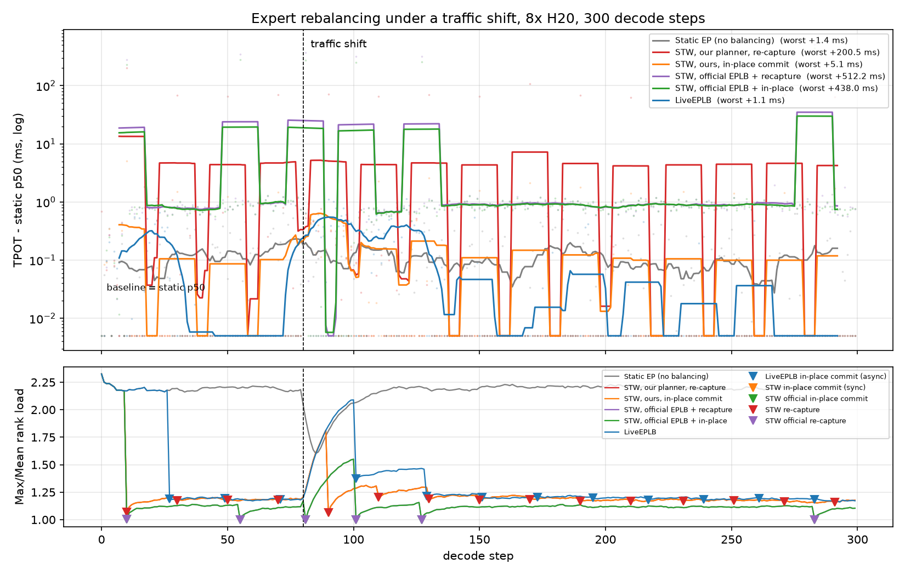

# Stage 4 实验记录

8×H20 单机八卡，NV18 全互联，CUDA 12.9，torch 2.7.0+cu126。

```bash
bash benchmarks/stage4_multilayer.sh           # 单元测试 + 40 层 + 1 层对照，全套
torchrun --nproc_per_node=8 benchmarks/run_synthetic_8gpu.py --layers 40
python3 benchmarks/plot_stage4.py 80           # 出 results/synthetic_tpot_timeline.png
```

## 要回答的问题

Stage 1-3 分别解决了"搬多少"、"怎么换不重录"、"怎么跨进程搬"。Stage 4 要回答的是
**合在一起之后，正在服务的请求感受到了什么**。

衡量指标只有一个：**TPOT（每个 decode step 的耗时）**，尤其是尾部。平均值没有意义——
停机重录是一次性的上百毫秒，摊进 300 步的均值里几乎看不见，但它完整地砸在当时那一个请求上。

## 实验设置

| 项 | 值 |
|---|---|
| 规模 | 256 专家，EP=8，每卡 32 base + 4 冗余 = 每层 288 物理槽 |
| 层数 | **40 层**（主实验）；1 层作为对照 |
| 流量 | Zipf(α=1.1)，每步 64 token/层，**热点集合在一个相位内固定**，每层的热点集合再错开 8 个专家 |
| 突变 | step 80 把热点集合轮转 64 个专家 |
| 步数 | 300 |
| 触发 | **逐层** Max/Mean > 1.35（只重排超标的层），冷却 20 步，统计 EMA decay 0.9，每 8 步 reduce 一次 |
| 显存 | 峰值 17.4 GiB/卡（MAX over ranks；stw_official 的 staging 与权重池并存期。池本体 ~8.9 GiB：40 层 × 36 槽 × 6.29 MB + graph） |

每层的热点集合刻意错开：如果 40 层共享同一个热点分布，它们会拿到同一个布局，
那 40 层实验就只是单层实验重复 40 遍，`_coalesce` 和 `layers_per_step` 也不会被真正走到。

五组策略。**stw / stw_inplace / live 共用同一套触发、同一台规划器（我们的）、同一批
拷贝任务**，唯一的区别是怎么把结果应用下去；`stw_official` 换掉的是**规划器本身**
（DeepSeek 官方 EPLB 全量重排），用它回答"官方停机到底要多少"这一问：

- `static` — 不均衡，对照底线
- `stw` — 停机式：规划、同步等拷贝完成、**真的重录 CUDA Graph**，全部在关键路径上。
  代表布局烧死在前向图里的引擎。规划器和 live 相同——**这一组只隔离"应用"的成本**
- `stw_inplace` — 停机式但持有路由表间接层：规划、同步等拷贝完成、**只 commit 路由表**，
  不重录。代表把 xLLM / SwiftBalancer 的切表技巧拿到手、但拒绝后台异步
- `stw_official` — **DeepSeek 官方 EPLB 规划器 + 全量重排**（每次提交约改 1400/1440 槽），搬权默认走**整车 staging**（占 ~14 GB 缓冲但 coalesce 搬得快）；`STW_OFF_MODE=walk` 是 cycle-walk（省显存但慢 5-10 倍），挑显存受限时开。再重录。
- `stw_official_inplace` — 同样的官方规划 + staged 搬权，提交时**只 commit 路由表不重录**。
省下的只是它的 1/8~1/5
  大头在它的规划和换手
- `live` — 本项目：后台线程规划、`transfer_stream` 搬运、非阻塞轮询、原地切表

让它们共触发逻辑是故意的。如果只让 stw 在突变后做一次均衡（第一版就是这么写的），
它的均衡曲线会比 live 差，而那个差距来自"被调用的次数少"，不来自机制本身，属于把对照组
打残之后再赢。

列名里的 **Max/Mean last100** 是拿最后 100 步（稳态，不含刚迁移完的窗口）的平均：
`单层 Max/Mean = 最忙卡负载 / 8 卡平均负载`（1.000 = 完美均衡，2.204 ≈ 8 分均摊里有一张卡
抗了 2.2 份），然后 40 层求均值。`commits` 是落盘的总提交次数。

## 主结果

### 40 层

（**2026-11-28 起为集群口径**：TPOT/split 按步取 8 rank 的 MAX，split 槽数为全集群 SUM，
commits/显存取 MAX；下述表格全部重跑自该口径，此前为 rank0 口径（见 stage5_debug_notes
S5-9）。停机类数字整体上修，结论方向不变。）

```
policy               TPOT p50      p99    worst  Max/Mean last100  commits
-------------------------------------------------------------------------------
static                 65.398   66.046   66.751             2.204        0
stw                    65.009  135.280  265.862             1.174       15
stw_inplace            64.987   67.652   70.517             1.174       15
stw_official           66.234  385.341  577.602             1.112        6
stw_official_inplace   66.213  322.807  503.403             1.112        6
live                   65.093   66.284   66.544             1.189       12
```

stw 的每一次停机，按阶段拆开（ms）。`drain` 是等本步自己发出的 replay 跑完——
**每一步本来就要付**，列出来是因为上一版把它算进了拷贝（见调试记录 S4-13）：

```
   step  slots    plan   drain    copy   recap    TPOT  vs p50  Max/Mean(该步)
     10    991    35.7    30.4     6.0   198.0   265.9  +200.8        1.07
     90   1090    38.1    27.5     3.7    69.6   137.4   +72.4        1.07
    130    324    14.5    51.1     1.8    69.3   135.3   +70.2        1.19
    251     25     2.2    62.6     0.5    67.5   132.2   +67.2        1.18
    291     26     2.1    62.4     0.7    63.8   128.9   +63.9        1.16
```

尾部那列 `Max/Mean(该步)` 是**这一步结束后的读数**（每层最忙卡÷均值再取层平均，即时、有采样噪声）：
两个停机组在提交的同一拍就掉到 1.07-1.19；live 在同一时刻（比如 step 90 还是 1.853）要在几次
提交之后才跟下来——它们自己的 12 次提交落在哪些 step、均衡如何收敛，见下文"收敛过程"一节。

`plan + drain` 在每一行都恒为约 66 ms，也就是一个 decode step：**规划完全藏在本步
replay 的背后，不花额外的钱**，搬得越少剩下要等的 replay 越长，此消彼长。于是停机的
净代价就是 `copy + recap`。15 次停机累计验证：

```
sum(copy + recap)  1199.4 ms
sum(TPOT - p50)    1202.3 ms      差 0.24%

```
其中 **recapture 占 98.1%**（recap 波动仍大——62-198 ms 的宽谱；step 10 那 198 ms 是本轮最大单步，但整体依然由重录主导）：

stw_inplace 跑同一批应用动作——**同样的触发、同样的方案，只是把"重录"换成和 live 一样
的那次 in-place commit**：

```
   step  slots    plan   drain    copy   recap   TPOT  vs p50  Max/Mean(该步)
     10    991    34.3    31.1     4.2     1.9    70.5    +5.5        1.07
     90   1090    38.6    27.9     3.9     1.6    70.5    +5.5        1.07
    130    324    14.3    50.9     1.7     1.7    68.0    +3.0        1.19
    251     25     2.2    62.6     0.5     1.6    66.8    +1.8        1.18
    291     26     2.1    62.4     0.6     1.6    67.1    +2.1        1.16
```

`recap` 一栏从 62-198 ms 掉到 1.6-1.9 ms
异步状态机**"这个对照，而不是"不用 LiveEPLB 的现成方案"。

stw_official（staged 版），完整账单（每次提交约改 1435/1440 槽/卡，slots 列为全集群总和）：

```
   step  slots    plan   drain    copy   recap    TPOT   vs p50
     10  11477   221.1     1.3    81.7    73.2    342.4   +276.2
    283  10940   242.7     1.4   290.9    76.0    577.6   +511.4
```

stw_official_inplace（staged 版），完整账单（重录换成原地切表后剩 ~2.7 ms；slots 同样为全集群总和）：

```
   step  slots    plan   drain    copy   recap    TPOT   vs p50
     10  11477   217.5     2.1    79.3     2.7    294.1   +227.9
    283  10940   236.3     1.5   268.9     2.8    503.4   +437.2
```

（注：walk 这三行为修复前 rank0 口径，未随本轮重跑；“慢 5-10 倍”是量级判断，不受影响。）

walk 版对照（`STW_OFF_MODE=walk`，显存到 ~0.4 GB，但慢 5-10 倍）：

```
policy                 step    plan     copy    recap    TPOT   vs p50
stw_official            10   211.1    440.0    62.2    713.5   +647.7   walk
stw_official           283   231.2   2362.5    57.2   2652.7  +2586.9   walk
stw_official_inplace   283   233.1   2371.4     2.7   2608.9  +2543.1   walk
```

四个事实一眼看到：
1. **plan 217-250 ms**：官方 EPLB 的规划本身比我们贵一个数量级（Stage 1 的 450 ms），全程压在关键路径上。
2. **copy 77-291 ms**：官方重排约一半槽换手、要两端 barrier，不再是毫秒级。
3. **recap 约占官方账单的 1/8~1/5**：重录 73-117 ms，省掉最多 ~117 ms；大头在规划和换手。
4. **walk 只建议显存受限时开**：5-10 倍慢的根因是 barrier round 串行（官方置换被拆成几十~上百个小环）
   + 丧失 pull_batch 的 376 GB/s coalesce。显存收益是 Pinned-Base 的设计红利，
   不是 walk 的发明。

### 为什么 stw_official 单次停机是 stw 的 4-7 倍，提交次数却最少

把 300 步里"每组各提交几次、每次多付多少、总停机时间"放一起数一遍，
这是上面那张图里最反直觉、也最先该解释清的一组数字：

```
policy               commits  每次停机（超自己 p50 部分）   累计停机
s───────────────────────────────────────────────────────────────────────
stw                     15     +63 ~ +201 ms               +1,202 ms
stw_inplace             15     +1.6 ~ +5.5 ms                +53 ms
stw_official             6     +276 ~ +511 ms              +2,119 ms
stw_official_inplace     6     +228 ~ +437 ms              +1,705 ms
live                    12     -0.5 ~ +1.5 ms                +32 ms
```

**为什么 stw_official 单次贵这么多（全部在关键路径上，缺一不可）**：
1. **plan 217-250 ms**——官方规划器要调全部 288 × 40 槽的目标分配；我们的 Pinned-Base
   增量规划 0.8-36 ms 而且完全藏在本步 replay 背后（drain>0 即免费）。
2. **copy 77-291 ms**——官方全量重排每次提交要改 ~1,435/1,440 个物理槽/卡（半个池子），
   且必须双 barrier 做跨进程 write/read 时序同步；我们每次全集群只动 25~1,090 槽。
3. **recapture 73-117 ms**——引擎不知道后台无副作用，改布局必须重录（stw/stw_official 都付）。

**为什么它的提交却也最少**：官方每次把整个系统一次性调到 Max/Mean ~1.11，
而逐层增量只把"超阈值的热点层"修到阈值附近，EMA 一漂移就又回到 1.35。所以
**6 次 vs 15 次=全量重置换来的少触发**——但它还是没赢：即使一次只有一半的次数，
stw_official 的停机总时长仍是 stw 的 ~1.8 倍。**

**换得与失得**：stw_official 换来 Max/Mean 1.112（比我们三组 1.166 ~ 1.189 低 5%），
但付出去的代价分别是：一次停机 5-8 个 decode step（live 是零）+ 每个 step 常驻约 +1 ms
（S5-6 未解之谜）。值不值，先看你的 SLO 是吞吐还是尾时延。

### 1 层（对照）

```
policy      TPOT p50      p99    worst  Max/Mean last100  commits
-----------------------------------------------------------------
static         1.727    1.762    1.764             2.218        0
stw            1.706   64.807   76.420             1.216        5
stw_inplace    1.705    2.282    2.615             1.216        5
stw_official   1.700   80.867   89.721             1.106        3
stw_official_inplace   1.699   11.271   38.966     1.106        3
live           1.729    1.982    2.325             1.224        3
```

```
stw            step 103   plan 1.7  drain 0.2  copy 0.4  recap 60.8   TPOT 63.1  +61.3
stw_inplace    step  83   plan 1.7  drain 0.1  copy 0.5  recap  0.5   TPOT  2.6   +0.9
               step 103   plan 1.5  drain 0.2  copy 0.2  recap  0.2   TPOT  2.1   +0.4
```

单层下 step 只有 1.7 ms，replay 瞬间就排空了（drain ≈ 0.2），所以规划这次是真的暴露在
关键路径上——但它只有 1.7 ms。stw 的 recapture 依然占停机的 **99%**（step 103：60.8/61.3）。


> 这张图是 **40 层、300 步**那组实验。上栏是每步 TPOT（log 轴）：红尖刺 = stw 的 15 次
> 图停机，橙色（stw_inplace）的每次停机只有 +1.6~5.5 ms，在这个尺度上根本看不出，蓝色的
> live 12 次提交完全看不见。下栏是每步的 Max/Mean 负载比 + 注入位置标记。两组 1 层数字另存
> 在 `results/stage4_4policy_1layer.json`，图只画 40 层。

四件事：

**1. live 的最差一步仍停在 static 的包络里。** 集群口径下 40 层 66.544 vs
static 的 66.751（**低 0.21 ms**）；1 层 2.325 vs 1.764，高 0.56 ms——单步毛刺，p99 只差
0.22，12 次提交步的 TPOT 中位 65.0 与常态无异。stw 的最差一步比 static **高 298%**，
stw_official **高 765%**（578 ms）、stw_official_inplace 高 655%。

> 这是本项目唯一不随规模漂移的结论，也是该当头条的那一条。

**2. 停机的代价几乎全是重录 graph。** 40 层 recap 62-198 ms、1 层 48-74 ms——宽谱本身
就是它作为元凶的指纹（与数据量几乎无关）。最能说明问题的一步是 **step 251**：全集群
只迁 25 槽（约 3 槽/卡，copy 合计 0.5 ms），照样付 67.5 ms 重录。


**3. "stw 凭什么一定要重录？"——它并不必须，但只要不重录，它就已经不是 stw 了。**
这是这轮实验里最值得摊开说的一组数。stw_inplace 和 stw 共享全部上层逻辑
（触发、规划、拷贝、rank 本地布局），**唯一不同是把"改布局"从重录换成和 live 一样的
in-place commit**。结果 worst 从 265.9 掉到 **70.5**，只比 live 差 **3.97 ms**；
1 层里 76.4 → 2.62，比 live 差 0.29 ms。

也就是说 LiveEPLB 的价值可以正交拆成两块：
- **“改布局不必重录”**：路由表间接层 + in-place pool + commit kernel。这一块拿走停机的主成分（copy+recap 中 recap 占 98.1%）。
  stw_inplace 拿着这三样、只删掉异步状态机——
  所以它恰好是"**LiveEPLB 的方案、但不要异步**"的对照，而不是"不用 LiveEPLB 的现成
  方案"。
- **"plan / copy / commit 不在关键路径上"**：异步状态机 + transfer stream + 非阻塞
  轮询。它把剩下的 2.9 ms 也拿掉。

所以“如果 stw 不 recapture，不是全面优于我们了吗？”——**不是全面优于，是还差 ~4 ms**。
这 ~4 ms 由三部分构成：大搬移时 plan+copy 超出本步 replay 的部分（step 10 / 90 的 +5.5、
+5.5）、copy 还压在关键路径上（0.5-4.2 ms）、commit 还压在关键路径上（1.6-1.9 ms）。
live 把这三样全挂后台，于是它自己的 **12 次提交那 12 步的 TPOT 中位 65.0**，和
cooldown 步没区别。**而 stw_official 把这两笔"省下的钱"和"规划的贵钱"一起算给读者**：
它付出的不是 4 ms，而是平均 ~350 ms（6 次共 2,119 ms），换来均衡 1.174 → 1.112 这 5%。

> 顺带回答"copy 为什么这么快"：单专家只有 6.29 MB，NVLink P2P 实测 147~272 GB/s
> （见 Stage 3），一次提交搬 1-138 槽 = 6 MB ~ 868 MB，平摊到 8 卡同时并发拉取，落在
> 0.2-3.8 ms。**它从来不是瓶颈，瓶颈是重录 graph 的那个 ~50 ms 固定开销**——所以
> Stage 1 把搬运量从 70.78 GB 压到 6.05 GB 的真正收益，不是"搬得快"，而是"**动不动
> 由我自己说了算**"。

**4. “快 N 倍”对层数极其敏感，不该当头条。** 40 层最差一步 265.9 vs 66.5 是 4.0x，
1 层是 76.4 vs 2.33 即 33x。倍数差 8 倍，不是 live 变差了，而是**我的单步慢了 38 倍，
而重录几乎没涨**——分母变了，分子没变。

**5. 均衡收益不随层数衰减。** static 2.204 → live 1.189，**峰值卡负载降低 46%**，
和单层的 2.218 → 1.224 几乎一致；stw 和 stw_inplace 都落在 1.174，与 live 差 0.016——
方向与 trace 一致（live 略差），机制见 stage5 的稳态差异分析。三者规划一致、拷贝一致，
区别只是“怎么应用”。40 层每层独立规划，收益逐层叠加。

## 触发判据：为什么是逐层，不是层平均

这一节是被一个问题逼出来的：**复制专家的收益判据是"某层的卡间负载是否均衡"，
可决定要不要触发的阈值取的却是 40 层的平均 Max/Mean，这合理吗？**

不合理，而且这两件事混在一个数字里：

**作为代价度量，层平均是对的。** 每层路由同样多的 token，所以每层的 mean 相同；
一个 step 的耗时正比于逐层最慢卡之和。于是 Max/Mean 的层平均**恰好等于**"比完美均衡
慢多少"。先把两个词说清楚：

- **单层 Max/Mean** = 了这一层里负载最大的那张卡的负载 ÷ 8 张卡的平均负载。若每层给
  8 卡各分 64/8 = 8 个 token，一张卡被路由到 16 个，则该层是 16/8 = 2.0。
- **实际步时惩罚** = 这个布局下真实跑一步比之前切到完美均衡布局慢了多少（%）。

构造 k 层倾斜、其余层均衡来验证两者相等：

| 倾斜层数 k | 层平均 Max/Mean = Σ_k(单层) / 40 | 实测步时惩罚 |
|---|---|---|
| 12 | 1.351 | +35.1% |

"12 层倾斜、其余 28 层均衡，层平均 = 1.351"、"这 40 层一步比完美均衡慢 35.1%"，
两者只小数点后一位，因为等式确实成立。

**作为门控，层平均是错的。** 冗余槽预算逐层独立，40 层就是 40 个互不相干的子问题。
一层极度倾斜被 39 层正常的稀释之后，那一层并不会因为"全栈平均还行"而变得不值得修。
盲区实测：**11 层倾斜时实际步时已经 +32%，其中 18% 可以靠复制收回，而层平均只有
1.32，阈值 1.35 不触发**——这 18% 就白白损失掉。

而且**我自己的 benchmark 看不见这个盲区**：`phase_probs` 给 40 层同一个 α，只轮转热点
集合，于是各层的 Max/Mean 几乎相同，max 恒等于 mean。盲区是我生成数据的方式造出来的。

### 走错的一版

第一反应是把门控从 mean 换成 max。GPU 上跑完否掉了：永不收敛——最差那层规划后仍在
1.35 以上，于是每过一次冷却就重新触发。stw 提交 3 → 15 次，p99 67.1 → 163.9 ms；
live 的拷贝步 27 → 72 步，只换来 2% 的均衡改善。

**这一版让我的对照实验更好看**（stw 被自己的门控打残了），所以必须否掉。

### 真正的缺陷和修法

缺陷不在 max 还是 mean，在**用逐层的判断去驱动整栈的动作**。规划器加 `layers` 参数，
只重排点名的层，其余层原样保留 `prev_phy2log`；门控改成"挑出所有超阈值的层，一层都没有
才 idle"。顺带加了**不回退保护**：在同一份权重上比较新旧布局的峰值卡负载，没有改善就
保留旧的——全量重规划时它拒掉了 164 次纯回退的拷贝。

代价是规划一次只看热点层，所以同样的流量突变要分几轮收敛；收益是每轮只搬该搬的。
40 层实测规划耗时从全量 58.8 ms 降到热点 2 层时的 3.5 ms。

详见调试记录 S4-12。

## 均衡质量：布局差 1-2%（轨迹级），服务成本不可区分

| | stw | stw_inplace | live |
|---|---|---|---|
| 40 层 | 1.174 | 1.174 | 1.189 |
| 1 层 | **1.216** | 1.216 | 1.224 |

两个规模的方向现在一致了（集群口径两轮重跑均如此）：live 略差 0.008~0.016。上一版把这 1%
判成“触发时机的抖动、不该归因机制”——这个判词需要修正：它与 trace 上 1.234 vs 1.207 同向、
约为各自稳态抖动的 3 倍，是**系统性差异**。机制：stw 与 live 共用同一台增量贪心规划器，
但它的定点依轨迹而定——触发节奏（冷却 20 步 vs 状态机 22-26 步）、决策用的统计（即时 EMA
×world vs all-reduce 后至多滞后 8 步的快照）、生效原子性（一次全量 vs 分层限流后台）都不同，
于是相变后两条轨迹停进不同的局部最优。**这是布局质量的差，不是服务成本的差**：TPOT 层面
live 的 worst 仍与 static 无法区分。详析见 stage5 文档的稳态差异段。

### 但收敛过程不一样，而且这段对 live 很不利

稳态相等掩盖了过程。突变之后 live 和两个停机变体的 Max/Mean（stw_inplace 的轨迹和
stw 完全重合——同一批提交发生在同一批 step——所以下表用 stw 代表它们俩）：

| step | 80 | 90 | 95 | 100 | 110 | 120 | 125 | 130 |
|---|---|---|---|---|---|---|---|---|
| live | 1.195 | 1.853 | 2.009 | **2.089** | 1.433 | 1.457 | 1.460 | 1.223 |
| stw | 1.204 | 1.067 | 1.218 | **1.283** | 1.205 | 1.265 | 1.282 | 1.189 |

**从 step 85 到 129，约 45 步里 live 的均衡一直差于停机变体，最大差距 0.81（step 100，
2.089 vs 1.283）。** 换算成单步代价：那一段 live 比完美均衡慢 109%，停机组只慢 28%。
代价的来源在下面两条。

原因有两条，都是机制性的，不是抖动：

1. **第一次修正来得晚。** stw 的检查周期严格是冷却 20 步（突变后在 step 90 就改完了）；
   live 的周期是冷却 20 步 + 规划若干步 + 拷贝若干步，`last_commit` 在提交时才重置，
   所以突变后第一次提交落在 step 101，**比 stw 晚 11 步**。
2. **一轮只修热点层，要几轮才收敛。** step 101 提交后均衡只降到 1.40 左右，直到
   step 130 的第二次提交才回到 1.20。逐层增量换来"每轮只搬该搬的"，代价就是多轮。

**所以这是一个真实的权衡，不是纯粹的改进**：live 买到的是尾延迟平稳（最差步 −0.2~+0.6 ms
vs stw 的 +63~+201 ms），卖掉的是突变后约 45 步内的均衡质量。真实服务里这 45 步意味着
吞吐短暂下降，而停机式是用一次 130-266 ms 的卡顿换立刻恢复
按尾延迟写的还是按吞吐写的，本阶段没有回答这个问题**。

缩短它可以调小 `cooldown`，或者允许一轮规划全部层，但前者提高提交频率、后者让每次拷贝
变大，都要重新测。本阶段没有扫这组参数。

> 这一段在上一版文档里被低估了：benchmark 原来读 `ctrl.phy2log`，而它在 COPYING 一开始
> 就被改成了新布局，于是 live 的均衡曲线提前几步"记了功"。现在 `phy2log` 只在提交时才
> 采纳（`test_imbalance_reports_the_layout_in_force_while_copying` 盯住这点），
> 曲线才是实际在役布局的。修之前这段的峰值看上去只有 1.46，修之后是 2.09。

## 控制器自身的开销

`ctrl_ms` 单独记录 `on_step()` 内部的耗时：

```
40 层  live:  p50 0.075 ms   p99 0.436 ms   max 0.733 ms   （集群口径，8 rank 取 MAX）
1 层   live:  p50 0.111 ms   p99 0.458 ms   max 0.732 ms   （同上）
```

300 步里没有一步超过 1 ms。这是修掉**三个**同步点之后的数字，三个都有同一个形状：
CPU 侧阻塞，而 TPOT 上完全看不见，因为它们和自己在等的那个 replay 精确重叠。

| | 修前最大值 | 原因 |
|---|---|---|
| S4-11 | 65.91 ms | `_reduce_stats()` 里的 `self.ema.cpu()` 是同步 D2H |
| S4-15 | 65.79 ms（step 27） | 第一次 commit kernel 的 CUDA 模块加载 |
| S4-15 | 64.33 ms（step 0） | 第一次 `record()`：EMA 的 pageable H2D + 首启 |

S4-11 在单层时只有 2.06 ms，被当成噪声放过了，40 层放大 32 倍才现形。S4-15 的两个
都是一次性首启开销，修法是在构造函数里预热（no-op commit + 全零 record）。

剩下的零点几毫秒（p50 0.08-0.11 ms）是状态机本体
`rank_load`（40 层的 `[40, 288]`）。

> **只看 TPOT 查不出这一类问题。** 必须单独计量 CPU 时间——真实引擎里这段 CPU 时间
> 本该用来准备下一步的输入。

## 零停机落在哪

| 环节 | 40 层实测 | 为什么不阻塞 |
|---|---|---|
| 统计 reduce | 40 KB，gloo | 后台线程；主循环只做一次异步 D2H + 信号量 |
| 规划 | 热点层 3.5 ms / 全量 58.8 ms | 常驻 worker 线程，主循环只查 `Event.is_set()` |
| 搬权重 | 每次提交 1 个到 138 个槽 | `transfer_stream` + `event.query()` 轮询，分多步发完 |
| 切表 | 12.6 us（Stage 3 实测） | 单次 launch 的 kernel，地址不变，graph 无需重录 |

**COPYING 状态一拍都不等**是整件事的落点：`event.query()` 返回 False 就直接拿旧路由表
继续 replay。旧表永远是一个完整、自洽的布局，所以"还没搬完"不是一个需要特殊处理的中间
状态，它就是上一个正常状态。

40 层下 live 用 **35 个 step 完成 12 次提交的拷贝**（平均 2.9 步/次），单层是 3 步 3 次
（1 步/次）。`layers_per_step` 的分摊机制到多层才真正生效——单层时 `pending` 最多 4 条，
永远够不着 16 槽的切片上限。

## 三套槽号

多层改造带来的真正复杂度不在算法，在编号。同一个"槽"在三个地方有三种编号：

| 在哪 | 形状 | 槽号范围 | 含义 |
|---|---|---|---|
| 规划器 | `phy2log [L, S]`、`log2phy [L, E, C]` | 0~287 | 全局槽：`rank * 36 + 卡内槽` |
| `MoEStack` 路由表 | `log2phy [L, E, C]`、`logcnt [L, E]` | 0~35 | 层内槽，每层自己的 pool 视图 |
| 拷贝任务 | `(dst_slot, src_rank, src_slot)` | 0~1439 | pool 槽：`layer * 36 + 层内槽` |

路由表**刻意停在层内编号**：`_route` 不变、commit kernel 仍然看到一块连续内存、
`P2PSwapper` 一行没改。只有生成拷贝地址时才把 layer 折进去（`local_tasks` 的
`slots_per_layer` 参数）。

`_retract()` 是三套编号唯一的汇合点：它拿着 pool 编号的 dst 集合，要在层内编号的表上
做摘除，于是先 `live_l + slot_offsets` 升到 pool 编号再比对。这里有个坑：
padding 是 -1，`-1 + 36` 会撞上下一层的真实槽 35，所以 `keep` 必须同时带 `live_l >= 0`
这一项。测试 `test_multilayer_pulls_land_in_their_own_layer` 专门盯这个。

## 边搬边跑，为什么路由不会出错

决定 token 去哪的只有 `log2phy`，权重在 `w_pool[slot]`。要保的不变量是一句话：
**正在被写的槽，一定不可从 `log2phy` 到达。**

三类槽各有依据：

| 槽 | 迁移期间的状态 | 依据 |
|---|---|---|
| base（每层前 32 个） | 全程只读 | Pinned-Base，规划器不把它们放进搜索空间 |
| 空冗余槽 | 表里是 -1 | 不可达，直接写（Stage 2 的论证） |
| **在役冗余槽** | 表里指着它 | 先提交摘除表，再写（见调试记录 S4-7） |

顺序由 CUDA 流语义保证，没有用锁，也没有用 atomic：

```
compute stream: … replay ─▶[摘除表 commit]─▶ replay ─▶ … ─▶[新表 commit]─▶ replay …
                                 │                              ▲
                  wait_stream(compute)                          │ 仅在 event.query() 为真后入队
                                 ▼                              │
transfer stream:            [peer copy ──────▶ event.record()]──┘
```

- **写之前**：`pull_batch` 里 `s.wait_stream(torch.cuda.current_stream())`，于是 transfer
  stream 必须等 compute stream 上已入队的一切跑完，其中包含摘除表的 commit kernel。
- **写之后**：新表的 commit 只在 `event.query()` 为真之后才入队，而它和 replay 同流，
  必然排在后续所有 replay 之前。

所以迁移窗口内，专家 e 的 token 继续走 e 的**旧副本集合**——那永远是一个完整自洽的布局。
代价只有一个：被摘除的那些专家在窗口内少一份副本，短暂地不那么均衡。

> 这也是为什么 commit kernel 不需要 atomic（Stage 3 的结论）：同流有序意味着 replay
> 不可能观察到半张表。而 `log2phy` 的**地址**被 graph 冻结、commit 是原地覆盖，所以
> 切表对 graph 完全透明，不触发重录。

多层没有改变这个论证，因为路由表是一整块 `[L, E, C]`，commit 一次换掉所有层；而拷贝
地址带 layer，不同层的 pull 落在 pool 的不同区段。benchmark 里 `verify_replicas()` 每轮
结束读一次权重里埋的 `(layer, expert)` 指纹，**跨层串写会被查出来**，四个策略都是 0 条。

## 两个没有解释清楚的数字

**其一：四个均衡组的 p50 不是同一个数。** 40 层 static 65.398 / stw 65.009 / stw_inplace
64.987 / live 65.093，最高的 static 和最低的 stw_inplace 差 0.41 ms。各轮重跑顺序也不稳定
（最新一轮 static > live > stw > stw_inplace）。均衡本身不该让
单步变快：这个 benchmark 里每步每卡算的 token 数固定，而且**合成 forward 对负载几乎不敏感**
所以现在的判断是：**0.4 ms 以内的 p50 差异在 run-to-run 抖动里，不该读成
机制差异**。（历史上 1 层规模出现过一次 stw 比 static 低 4% 的，那一条仍然没有解释。）

**其二：换成官方布局后，每步平白慢 1 ms，排除了四个嫌疑还没确诊。** `stw_official`
和 `stw_official_inplace` 的 p50 都比同条件组稳高 ~1 ms（合成 66.2 vs 65.0-65.4；trace 67.1 vs 66.5-66.8），
起病点是第一次换布局（step 10），之后不再加深。**排除过的**：显存分配（给 static
同样分配，p50 不变）、每步统计开销（Ctrl 时间一致）、recapture（inplace 组不重录也慢、
stw 重录 15 次却不慢）、规划器的 Python（只有提交步才跑）。剩下唯一有测量证据的说法是
**官方布局自身访存形态更差**——static + 官方布局 step 0 就装好、零迁移时 p50 已经
65.254（+0.45；该探针为修复前轮次，未随本轮重跑）——但也只解释了约一半。
详见调试记录 S5-6。它不影响结论方向（对照组更慢反而对我们有利），记下它是因为
"能解释"和"测量过"是两回事。

## 测试

全套 56 个，`bash benchmarks/stage4_multilayer.sh` 跑完：planner 17、moe_layer 17、
p2p 11、controller 11。

`tests/test_controller.py` 用一个 `FakeSwapper` 替换 P2P 层，把 pull 变成本地填充，
于是整套状态机可以在单进程、单卡里测。

| 测试 | 断言 |
|---|---|
| `test_uniform_never_plans` | 均匀负载下 0 次规划、0 次拷贝 |
| `test_skew_goes_through_every_state_in_order` | 状态序列严格是 warmup → planning → copying → commit |
| `test_commit_installs_rank_local_table` | 提交后的表是层内槽号，base 槽原样保留，副本权重内容正确 |
| `test_copying_never_blocks` | 人为拖慢拷贝 200 ms，COPYING 期间每次 `on_step` < 5 ms，且路由表不变 |
| `test_cooldown_rate_limits_planning` | 冷却窗口内不重新规划，窗口过后恰好再规划一次 |
| `test_unchanged_plan_copies_nothing` | 统计不变时反复规划，不产生任何拷贝和提交 |
| `test_occupied_slot_is_unlinked_before_overwrite` | 覆盖仍在服务的冗余槽之前，它必须已从路由表摘除 |
| `test_multilayer_pulls_land_in_their_own_layer` | 4 层各自有热点，每层的副本权重必须来自**本层**的源槽 |
| `test_multilayer_pulls_are_paced` | 拷贝量超过单步上限时，COPYING 跨多步，且每个槽只拉一次 |
| `test_one_skewed_layer_among_balanced_ones_triggers` | 16 层里只有 1 层倾斜也必须触发（层平均低于阈值） |
| `test_imbalance_reports_the_layout_in_force_while_copying` | COPYING 期间 `phy2log` 必须仍是在役布局，提交后才换（见 S4-16） |

planner 新增三个盯 `layers` 参数和不回退保护：
`test_layers_restricts_what_is_replanned`、`test_layers_empty_is_a_no_op`、
`test_replan_never_regresses_a_layer`。另外 `log2phy_from_phy2log` 和 `_diff_tasks`
向量化后，各用 300 / 400 组随机输入对着原来的 Python 循环做了差分测试（见 S4-14）。

`test_occupied_slot_is_unlinked_before_overwrite` 盯的是真竞态，见调试记录 S4-7。
`test_copying_never_blocks` 的第一版自己踩了坑，见 S4-9。
`test_one_skewed_layer_among_balanced_ones_triggers` 的第一版是**空断言**：
夹具里那一层倾斜 7 倍，光层平均就已经 1.377 超过阈值，于是无论门控是 mean 还是逐层都会
过——是断言里顺手加的那句 `mean is 1.377` 把它自己抓出来的，夹具改小到 10 倍。

`tests/test_moe_layer.py` 新增 3 个 `MoEStack` 测试，其中
`test_stack_layer_reads_its_own_pool_range` 验证层 l 的槽号解析落在
`[l*36, (l+1)*36)`——同一个层内槽号在两层里必须取到不同的权重。

**这组测试没覆盖到的东西**：`test_occupied_slot_is_unlinked_before_overwrite` 里的
`FakeSwapper` 在填充前先 `torch.cuda.synchronize()`，所以它断言的是**host 端的调用顺序**
——摘除表的 commit 先被调用。而真机上保序的是上一节那条 `wait_stream` 路径，即
"commit kernel 和 peer copy 分属两条流但有依赖"。那条路径在当前测试里是被旁路的。
要真正测它，得让 FakeSwapper 在 transfer stream 上跑一个耗时 kernel 再读表，
单卡也能做，只是还没写。

`tests/test_moe_layer.py` 新增 3 个 `MoEStack` 测试，其中
`test_stack_layer_reads_its_own_pool_range` 验证层 l 的槽号解析落在
`[l*36, (l+1)*36)`——同一个层内槽号在两层里必须取到不同的权重。

**这组测试没覆盖到的东西**：`test_occupied_slot_is_unlinked_before_overwrite` 里的
`FakeSwapper` 在填充前先 `torch.cuda.synchronize()`，所以它断言的是**host 端的调用顺序**
——摘除表的 commit 先被调用。而真机上保序的是上一节那条 `wait_stream` 路径，即
"commit kernel 和 peer copy 分属两条流但有依赖"。那条路径在当前测试里是被旁路的。
要真正测它，得让 FakeSwapper 在 transfer stream 上跑一个耗时 kernel 再读表，
单卡也能做，只是还没写。

## 已知局限

- **合成 forward 比真 MoE kernel 慢，且对负载几乎不敏感。** `w = w_pool[slots]` 会把
  `[T, 3, 512, 2048]` 实体化，T=64 时每层约 400 MB 的访存，而真正该读的只有 36 个槽
  226 MB。所以 65 ms/step 偏大（真实 Qwen3.6-35B-A3B 在 H20 上应更低），
  **这让"停机只相当于两三个 step"的换算偏向于我有利的方向**；停机的绝对值
（本轮 62~198 ms）是硬件和 graph 规模决定的
  TPOT 去除。**另外，这个 kernel 的耗时几乎不随流量倾斜变化**，所以四组的 p50 几乎相同——
  这是刻意把"应用成本"从"均衡收益"里隔离出来的代价：真实 MoE kernel 里不均衡组的 p50
  确实更慢，那部分收益在这个 benchmark 里**没有被计入**。
- **40 层的流量分布太整齐，掩盖了门控的盲区。** `phase_probs` 给每层同一个 α，只轮转
  热点集合，于是各层的 Max/Mean 几乎相同。真实模型里各层的倾斜程度差别很大，
  而"少数几层极度倾斜"正是层平均门控看不见的情形（S4-12）。门控已经改成逐层，
  但**这个 benchmark 仍然验证不了它的价值**——要靠 Stage 5 的真实 router trace。

- **"同流"是一个不受代码保护的约定。** 保序论证整个建立在"`on_step()` 和
  `replay()` 处于同一条 current stream"之上。调用方只要把 `on_step` 包进
  `with torch.cuda.stream(other)`，摘除表的 commit 就会落到另一条流上，`wait_stream`
  等不到它，竞态立刻回来——而且不报错。现在只在 docstring 里写了这个要求，没有运行时
  检查。可以在 shard 里记下录制时的 stream，commit 时比对一次。

- **统计快照环满了会阻塞主线程。** `snapshot_buffers=4`，第 5 个未完成的 reduce 会让
  `_reduce_stats()` 等在信号量上。这里**故意不用"跳过"**：跳过是本地决策，一个 rank 跳过
  别人都执行的集合通信就是死锁（S4-5 踩过）。默认配置下（8 步一次 vs 几毫秒的 gloo
  all-reduce）实测从未等过，但这是一条真实存在的阻塞路径。

- **多节点仍然不支持。** CUDA IPC 是单机边界，这是 Stage 3 的硬约束。目标模型
  （Qwen3.6-35B-A3B，8×H20 单机 EP=8）落在这个边界内。

- **每张卡的流量分布相同。** 合成负载让 8 个 rank 看到同一个 token 分布，所以"各 rank
  独立规划得到同一结果"这个性质没有被真正压力测试。真实场景下各 rank 的局部统计不同，
  全靠那次 all-reduce 保证一致。

- **统计 reduce 的一致性依赖"每个 rank 每步都调 `on_step`"。** 这是 decode 循环的性质，
  但如果某个 rank 提前结束或跳步，gloo 集合通信会挂住。代码里的处理是把 reduce 做成
  **无条件、固定步长**的，不受状态机影响（见 S4-5），这是目前最弱的假设。

- **stw 的统计是白送的。** 对照组直接用本地 EMA 乘 world size，没付集合通信的钱；
  live 付了（虽然在后台）。这个偏向对照组。

- **重录耗时波动极大。** 本轮（集群口径）40 层 15 次是 62.4 ~ 198.0 ms，1 层 5 次是 47.9 ~ 74.4 ms，
  历史上单层出现过 31 ms 和 95.7 ms，前几轮同样代码的 40 层出现过 112.2 ms。
  同一份代码不同轮次的 stw p99 也在 67 ~ 160 ms 之间漂。**可信的是量级（几十毫秒）和“与搬运量
  无关"这个性质，不是任何具体数值**；波动来自显存碎片和 cuBLAS workspace 重新申请。

- **突变后约 45 步内 live 的均衡差于停机式**，峰值 2.089 vs 1.283。见上面"收敛过程"一节，
  这是逐层增量 + 冷却时钟在提交时才重置的直接后果，是真实的权衡而不是抖动。

- **没测多 rank 并发 pull 的带宽竞争。** 8 张卡同时向各自的源卡拉取，总带宽如何分配
没有测量，只知道端到端没有出现尖刺。copy 段实测 0.5-6.0 ms（集群口径），但**上一版文档里从这个数
  反推出的"约 320 GB/s"是蒙对的**：当时的 copy 列把等 replay 排空的时间算了进去
  （S4-13），只在规划最久的那几步才碰巧接近真值。现在也仍然是从总耗时反推，不是直接测量。
