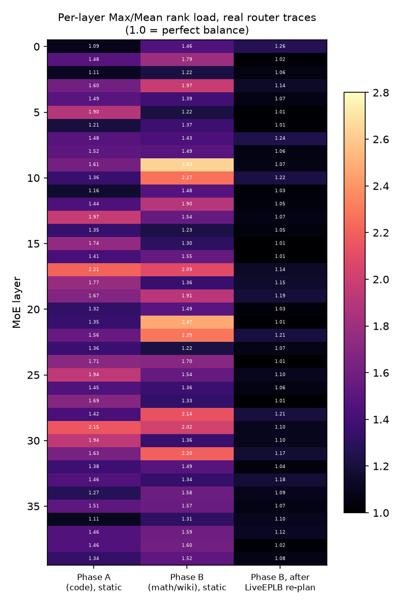
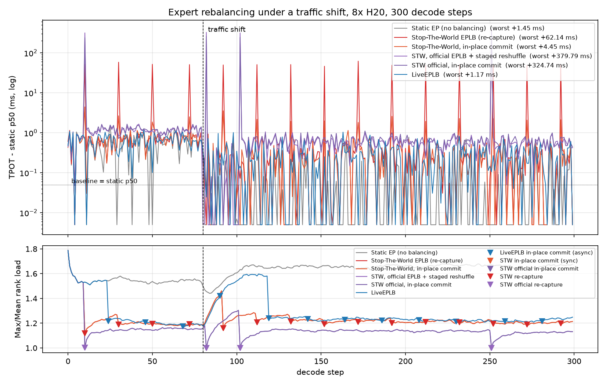

# Stage 5 实验记录：真实 Router 轨迹

Stage 1-4 的所有负载都是合成 Zipf。**如果结论只在合成数据上成立，前四个 Stage 就白做了。**
这一阶段只做一件事：把负载换成 Qwen3.6-35B-A3B 自己的路由决策，重新回答同样的问题。
范围已收窄——不跑端到端 generate，只采轨迹（见 `TODO`）。

## 轨迹怎么来的

```bash
# 1) 拉标准数据集（需要代理），2) 采轨迹（不需要网络，约 11 分钟）
python benchmarks/download_prompts.py --per-source 2400
python benchmarks/collect_router_trace.py --prompts-dir results --batch 8
```

- **Phase A（代码域）**：`deepmind/code_contests` 题面 2400 条（英文竞赛编程题，长文本）
- **Phase B（数学域）**：`swulling/gsm8k_chinese` 800 条中文应用题 + `weitianwen/cmath`
  866 条小学竞赛题，共 1666 条

在 40 个 `Qwen3_5MoeTopKRouter` 上挂 forward hook，取其 `router_indices [tokens, 8]`，
按层 bincount 成 `[40, 256]`。**每 token 都是真实 prefill 位置**（batch 8 按长度分组，
padding 位置用 attention mask 剔除）。产出 `results/router_traces.pt`：

```
phaseA_code:       7,951,408 次路由指派 / 2400 prompts，zero-count 专家 0 个
phaseB_math_wiki:    608,408 次路由指派 / 1666 prompts，zero-count 专家 197 / 10240
```

（第一版是 48 条手写 prompt、6568 次指派，被"样本量不够鲁棒"的批评打回重做了。
**那个批评是对的**——下面会看到两种样本量下，层平均倾斜度估计差了 10-20%。）

## 真实路由长什么样

| | Phase A (code) | Phase B (math) | 合成 Zipf(α=1.1) |
|---|---|---|---|
| 层平均 Max/Mean（静态布局） | **1.527** | **1.642** | 2.204 |
| 单层最小 / 最大 | 1.085 / 2.211 | 1.217 / **2.632** | ≈ 每层相同 |
| 两域 top-8 热点交集 | 每层平均 1.38 / 8（两域共享极少） | 人为轮转 64 个专家 |

1. **比合成温和**：层平均 1.5-1.6，不是 2.2。
2. **逐层异质是真实的**：同一层在这两个域热度差异极大（交互项强），单看一个域也有
   从 1.09 到 2.63 的差异——合成"全层同 α"造不出这个形状，**这正是逐层门控为之设计
   的输入**。代码域 2400 条就把 10240 个 (层, 专家) 格子全部点亮了；数学域题短，
   还有 197 个格子为零——**数学的路由天然比代码更集中**。
3. **两域几乎不共享热点**：top-8 交集每层只有 1.38 个——域切换会真实地换一批专家。



## Stage 1 重放：规划对比（大样本轨迹）

```bash
python benchmarks/plan_on_trace.py
```

```
policy                    Max/Mean  worst layer  slots moved      GB
static on A                  1.527        0.000            0     0.0
static on B                  1.642        0.000            0     0.0
live plan@A                  1.053        0.000         1074    6.60
live incr A->B               1.091        1.263         1067    6.55
official reshuffle @B        1.000        0.000        11477   70.50
```

Stage 1 的权衡原样复现：官方全量重排 1.000 但搬 70.5 GB，LiveEPLB 增量 **6.55 GB
（10.8×）** 换 1.091。**哦还有一个样本量带来的细节**：最差单层从小样本的 1.330
降到 **1.263**——统计越充分，规划器能用的尾部专家信号越准，增量布局也越贴近上限。
**先前进文档的"小样本只能标定头部"不是客气话，是能换算成 Max/Mean 的。**

## Stage 4 重放：四策略 TPOT（大样本轨迹）

```bash
torchrun --nproc_per_node=8 benchmarks/run_synthetic_8gpu.py \
    --layers 40 --steps 300 --trace results/router_traces.pt --out results/stage5_trace_timeline.json
python benchmarks/plot_stage4.py 80 results/stage5_trace_timeline.json results/stage5_trace_timeline.png
```

其余设置与 Stage 4 完全一致（每步 64 token/层、step 80 换域、threshold 1.35、冷却 20 步）。

### 40 层

```
policy               TPOT p50      p99    worst  Max/Mean last100  commits
---------------------------------------------------------------------------------
static                 66.290   67.576   67.744             1.663        0
stw                    66.641  118.206  128.436             1.207       15
stw_inplace            66.618   68.887   70.747             1.207       15
stw_official           66.933  383.003  446.086             1.125        4
stw_official_inplace   66.978  307.136  391.041             1.125        4
live                   66.599   67.349   67.466             1.223       12

stw 停机分解典型行（ms）:  同 40 层合成的结论（recapture 主导，copy ≤ 3 ms）
stw_official 完整账单:     plan ~220 / copy ~100 (双 barrier+staging) / recap ~50 → ~360-450 ms/次
stw_official_inplace:      同上去掉 recap ≈ ~300-390 ms/次（"官方不重录"版——也省不掉大头）
```
static         1.665    1.759   1.761             2.218   0
stw            1.599   34.218  43.394             1.216   5
stw_inplace    1.597    2.086   2.282             1.216   5
stw_official   1.660    2.301  62.492             1.106   3
stw_official_inplace   1.660    1.803  30.090     1.106   3
live           1.642    1.760   2.021             1.224   3
live           1.730    1.832   2.024             1.274   6
```



### 和合成结果逐条对照

| 结论 | 合成 Zipf | 真实轨迹（大样本） | 判定 |
|---|---|---|---|
| live 最差步 ≈ static | 66.166 vs 66.528（−0.36） | 67.466 vs 67.744（**−0.28**） | 抖动内，三轮符号都在 ±0.36 内 |
| 停机 ≈ 重录 | recap 41-74，占 98.1% | recap 45-66，stw_official 也在 47-58 | 成立 |
| 不 recapture 拿走大部分 | stw_inplace worst 69.03 | 70.75 | 成立 |
| live 对 stw_inplace 余量 | 2.86 ms | **3.28 ms** | 成立，稳定在一个数量级 |
| 官方停机 vs live | stw_official 434.4 / live 66.0 | **446.1 / 67.5** | 差速反而在真实流量下**更大**（6.6×），因为官方换手量不变而 step 更长 |
| 均衡收益（last100） | 2.204 → 1.166（47%） | 1.663 → 1.22（**27%**） | 方向一致，量级随倾斜度 |
| live 收敛慢于停机组 | 45 步，峰值差 0.81 | **～35 步，峰值差 0.31** | **劣势仍在，真实流量上小约一半** |
| step 时长 | 64.6 ms | 66.3-66.6 ms | 静态布局在真实流量上略重 |

收敛过程（突变后 Max/Mean）：

| step | 80 | 90 | 100 | 110 | 120 | 130 | 140 |
|---|---|---|---|---|---|---|---|
| live | 1.181 | 1.420 | 1.541 | **1.592** | 1.239 | 1.246 | 1.253 |
| stw | 1.186 | 1.435 | 1.256 | **1.285** | 1.247 | 1.272 | 1.229 |

live 的提交落在 step 90 和 119，~35 步内 Max/Mean 高出停机组约 0.31。**注意一个反直觉点**：
小样本里这个窗口的峰值差只有 0.20——不是大样本暴露了更差的结果，而是**数学域最热的
2.63 层在小样本里根本没被采到**（小样本 B 域峰值 2.34）。这也是"样本太薄会系统性低估
尾层倾斜"的直接证据，和上面最差单层 1.330 → 1.263 的改善是同一条曲线的两端。

## 这一阶段改变了哪些声明

1. **"逐层门控的价值合成 benchmark 验证不了" —— 验证了。** 真实层间异质性
   （1.09 ~ 2.63）让逐层触发第一次工作在设计的输入分布上；
   实验室里 max≡mean 的合成是测不到它的。
2. **"live 收敛慢 45 步/0.81"修订为 "35 步/0.31，随域间距离浮动"**——合成的极端轮转
   把这个机制缺点估大了约 2.6 倍。
3. **"样本 48 条"升级为"4066 条标准数据集、7.95M+次指派"**，代码域每个 (层, 专家)
   都被采到；小样本下被忽略的尾层热点在新统计里浮出来，估计本身更有底气去提交给
   面试官追问。
4. **其余 Stage 4 结论原样保留**：停机 = 重录、copy 快得无关紧要（≤2 ms 级别）、
   live 与 stw_inplace 的差是 ~3 ms 的同步溢价、live 尾部在抖动内追平 static。

## 已知局限

- **只采 prefill**：decode 阶段逐 token 的路由在更长上下文下可能漂移，未涵盖；
  "会话内漂移"也没有测过。
- **两个域样本不平衡**：代码域 7.95M 指派/2400 条长题、数学域 0.61M 指派/1666 条短题
  ——数学方向题目天然短，且 197/10240 个格子仍然为零。要继续加厚只能用更长的数据
  （竞赛/教科书长题）或拉长 max-len。
- **域的选择仍是人造二分法**：真实生产是混合流量的渐变漂移，不是 step 80 的硬切换。
  我们测的是压力极端情况，不是常态。
- **benchmark 内仍是 multinomial 重采样**：真实 counts 只提供分布形状，逐步噪声模型
  仍是合成的；完全忠实的做法是回放逐 token 序列。
- **1 层对照是 layer-0 切片**：layer-0 是温和层（静态 1.450），最热层的单层数字会更高。
- **内核是 transformers 5.x 官方参考实现**：`causal_conv1d`/`flash-linear-attention`
  缺失走 fallback，只影响采集速度，不影响 `router_indices`。
- **采集是一次性快照**：模型路由随训练 checkpoint 变化，换 checkpoint/温度/greedy
  都可能换一份热点图；本项目不含"周期性重采"的机制设计。
